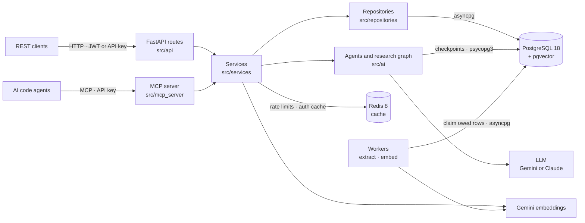

# Knowledge Platform

[](https://github.com/Serafim-Yablonski/KnowledgePlatform/actions/workflows/ci.yml)

Knowledge Platform lets teams upload documents into isolated workspaces, search them semantically and ask questions about them (RAG), from REST clients or directly from AI code agents over the Model Context Protocol (MCP). Uploads are validated, then chunked and embedded by background workers that claim the work from PostgreSQL; search runs on PostgreSQL with pgvector. REST and MCP are thin adapters over the same services. A multi-step research agent plans queries, gathers evidence until it is sufficient, and streams a synthesised report.

The emphasis is on correctness you can check: layer rules enforced by import-linter, `mypy --strict`, ~800 tests against real PostgreSQL 18 (testcontainers, failure paths with injected faults), and 28 architecture decision records that name the alternatives they rejected. Each highlight below links to the test or ADR that proves it.

## Highlights

- **MCP server for code agents.** MCP SDK 2.x, serving only the stateless 2026-07-28 protocol, so identity travels with every request. Retrieval-first tools (`list_workspaces`, `search_documents`, `list_documents`, `read_document`) with typed outputs and effect annotations; Origin is checked before authentication. Tested through the real SDK client, including two users and concurrent callers who each see only their own data. [ADR-021](docs/decisions/021-mcp-sdk2-handshake-free.md), [ADR-023](docs/decisions/023-mcp-retrieval-first-tools.md), [tests](tests/integration/test_mcp_protocol.py)
- **One service layer, enforced.** Routes → services → repositories, assembled in a single composition root. Import-linter contracts forbid building repositories anywhere else and keep services, repositories and domain free of FastAPI/Starlette. [ADR-018](docs/decisions/018-composition-root.md), [contracts](pyproject.toml)
- **Workspace isolation.** Role-based permissions (owner, admin, member, viewer); every workspace-scoped query filters by workspace, and non-members are refused at the service, REST and MCP layers. [ADR-004](docs/decisions/004-multi-tenancy-workspace.md), [REST tests](tests/api/test_documents.py), [MCP tests](tests/integration/test_mcp_server.py)
- **Background document processing without a broker.** The documents table is the work queue: an upload commits only its row, and workers claim owed documents with `FOR UPDATE SKIP LOCKED` and a lease, so a document whose worker dies is claimed again rather than forgotten: tested with real processes, a killed worker's lease runs out and the next claim counts the attempt, and a crash loop ends `FAILED` (`interrupted`) after five. (The full failure matrix is the next step, see the roadmap.) Extraction and embedding are separate services: only extraction is memory-capped, only embedding holds the provider key. Retries use full-jitter backoff within a per-phase attempt budget, each attempt has a timeout shorter than its lease, and a stopped worker releases its running attempts after a grace period. Racing runs can't leave a document with two chunk sets (each replaces the whole set under the document's row lock; a unique constraint backs it). Every failure ends `FAILED` with a reason (`no_text`, `unreadable_file`, `extraction_timeout`, `extraction_too_large`, `embedding_failed`, `internal_error`, `interrupted`): status writes are guarded transitions, only phases that touch the outside world are retried, and PDFs are parsed in a child process killed at its own timeout or under the memory cap (an out-of-memory kill counts as an attempt, not a verdict). [ADR-025](docs/decisions/025-document-pipeline-state-machine.md), [ADR-027](docs/decisions/027-documents-table-is-the-work-queue.md), [queue tests](tests/integration/test_work_queue.py), [runner tests](tests/integration/test_runner.py), [worker process tests](tests/integration/test_worker_process.py)
- **Cursor pagination.** Composite `(created_at, id)` cursor, no OFFSET; pages stay stable while rows are inserted. [ADR-005](docs/decisions/005-cursor-pagination.md), [tests](tests/integration/test_document_repository.py)
- **Sliding-window rate limiting.** Redis sorted sets, `Retry-After` and RateLimit headers, fail-open or fail-closed chosen per route. [ADR-009](docs/decisions/009-sliding-window-rate-limit.md), [tests](tests/unit/test_rate_limiter.py)
- **Authentication.** JWT for users; API keys for agents, stored as SHA-256 hashes, with `last_used_at` writes throttled through Redis. Membership and API-key lookups are cached in Redis and invalidated on write. [ADR-019](docs/decisions/019-api-key-last-used-throttle.md)
- **Model-agnostic agents.** PydanticAI agents with typed, validated outputs; the LLM is a `provider:model` setting (Gemini or Claude). Agent and graph tests run without API calls (`TestModel`). [ADR-010](docs/decisions/010-pydanticai-over-langchain.md), [tests](tests/ai/)
- **Observability with a trust boundary.** OpenTelemetry traces exported to Logfire from the API and the workers; an upload's trace continues into every worker attempt, through the trace context stored with the document row. Neither the API nor the workers adopt trace context sent from outside, and traced embedding calls never carry the API key. [ADR-020](docs/decisions/020-trace-context-trust.md), [tests](tests/unit/test_observability.py)
- **Upload validation.** Content checks, server-generated file names on disk, and cleanup after a failed write. [failure tests](tests/integration/test_document_upload_failures.py)

## Architecture



Services, repositories and agents are built only in `src/composition.py`. An upload only commits its document row: that row is the work owed, and the workers claim it from PostgreSQL. The API and the workers export traces to Logfire.

## Tech stack

| Layer | Technology |
|---|---|
| Language | Python 3.14 |
| Web | FastAPI 0.136, Pydantic v2 |
| Database | PostgreSQL 18 + pgvector (HNSW index), SQLAlchemy 2.0 async (asyncpg), Alembic |
| Background jobs | PostgreSQL as the work queue (`FOR UPDATE SKIP LOCKED`, leases), asyncio workers; Redis 8 as a cache |
| AI | PydanticAI 1.89, LangGraph 1.1 (`AsyncPostgresSaver`), Gemini `gemini-embedding-001` (768 dims) |
| MCP | MCP Python SDK 2.3 (Streamable HTTP, protocol 2026-07-28) |
| Observability | OpenTelemetry + Logfire, structlog (JSON logs with trace and span ids) |
| Tooling | uv, ruff, mypy `--strict`, import-linter, pytest + testcontainers |
| Delivery | Docker (multi-stage, non-root), Docker Compose, GitHub Actions |

## Quick start

Requires Docker and a Google AI API key.

```bash
git clone https://github.com/Serafim-Yablonski/KnowledgePlatform
cd KnowledgePlatform
cp .env.example .env   # set GOOGLE_API_KEY, and SECRET_KEY to the output of: openssl rand -hex 32
make migrate           # starts Postgres and applies the migrations
make run               # API + MCP, extract and embed workers, Postgres, Redis
```

- API docs: http://localhost:8000/docs
- Health (database and cache, plus how long uploads wait for a worker): http://localhost:8000/health

Models are set in `.env`:

| Role | Variable | Default |
|---|---|---|
| Embeddings (Gemini only) | `EMBEDDING_MODEL` | `gemini-embedding-001` |
| Questions, research steps | `LLM_MODEL` | `google-gla:gemini-3.5-flash-lite` |
| Research synthesis | `LLM_STRONG_MODEL` | `google-gla:gemini-3.8-flash` |

To use Claude, set `ANTHROPIC_API_KEY` and e.g. `LLM_MODEL=anthropic:claude-haiku-5-5`; no code changes.

### Connect an MCP client

```bash
make mcp-config   # creates an API key and prints how to connect a client
```

It prints the `claude mcp add` command for Claude Code, plus the URL (`http://localhost:8000/mcp`) and `Authorization` header for any other client. The server speaks only the handshake-free protocol (2026-07-28 and later); clients on older, session-based revisions are refused with the spec's errors. Question answering stays REST-only: an MCP client is already an LLM, so it gets the evidence rather than a second model's answer.

## REST API

Interactive docs at `/docs`. All workspace routes require membership.

| Endpoint | Purpose |
|---|---|
| `POST /api/v1/auth/register`, `/login`, `/refresh`; `GET /me` | Users and JWT tokens |
| `POST/GET /api/v1/auth/api-keys`, `DELETE /api-keys/{id}` | API keys for MCP clients |
| `POST/GET /api/v1/workspaces`, `GET/PATCH/DELETE /{id}` | Workspaces |
| `POST/GET /api/v1/workspaces/{id}/members`, `DELETE /members/{user_id}` | Membership |
| `POST/GET /api/v1/workspaces/{id}/documents`, `GET/PATCH/DELETE /{document_id}` | Upload (processed in the background), list (cursor-paginated), manage |
| `POST /api/v1/workspaces/{id}/search` | Semantic search |
| `POST /api/v1/workspaces/{id}/ai/ask` | RAG answer with sources and confidence |
| `POST /api/v1/workspaces/{id}/ai/research`, `GET /{thread_id}`, `GET /{thread_id}/stream` | Research agent: start, status, SSE stream of the report |

## Tests and CI

```bash
make ci         # ruff, import-linter, mypy --strict, full test suite with an 85% coverage gate
make test-int   # integration tests only (needs Docker)
```

Integration tests run against PostgreSQL 18 + pgvector in testcontainers, never SQLite; failure paths that touch the database are tested with injected faults, and the workers with real processes that are killed, stopped and crash-looped. GitHub Actions runs lint (ruff, import-linter), type checking, unit, integration, API and AI test jobs in parallel, combines their coverage behind the same 85% gate, and builds the Docker image and checks that it migrates and starts healthy against real Postgres and Redis. Actions are pinned to commit SHAs and the workflow token is read-only.

## Observability

Every request is traced. An `/ai/ask` request, for example:

```
POST /api/v1/workspaces/{id}/ai/ask                 FastAPI
└─ ai_ask        question_length, answer_length, confidence, source_count, tool_calls_count, gen_ai.usage.*
   ├─ search     query_hash, top_k, min_score, result_count, top_score, search_latency_ms
   │  ├─ embed_texts   model, dimensions, embedding_batch_size, embedding_api_duration_ms
   │  └─ asyncpg query
   └─ LLM HTTP calls (httpx)
```

Set `LOGFIRE_TOKEN` in `.env` to export to Logfire; without it nothing is exported.

## Status and roadmap

Working and tested: everything under Highlights. In progress:

- **Durable research.** Run the research graph in a worker, resumable from its Postgres checkpoints, with human approval of the research plan before retrieval and a structured report with validated citations; then expose it as MCP tools. Today it runs in-process: a crashed run is not resumed. [ADR-011](docs/decisions/011-langgraph-checkpointer.md)
- **Pipeline acceptance suite.** Kill, database-loss and race scenarios run end to end, so every upload provably reaches `INDEXED` or `FAILED` without operator action; a re-index command.
- **Retrieval evaluation.** Chunk-level ground truth stored as answer spans, on a corpus with overlapping topics, used to choose the chunk size and score threshold. [ADR-024](docs/decisions/024-remove-eval-harness.md)
- **Abuse and cost controls.** A request body limit before uploads are buffered, per-user cost limits.

## Project structure

```
src/
  api/            REST routes (thin: validate, call a service, return a schema)
  mcp_server/     MCP server, auth middleware, tools
  composition.py  the only place repositories and services are built
  services/       business logic, framework-free
  repositories/   SQLAlchemy queries behind typing.Protocol interfaces
  domain/         value objects and enums
  models/         ORM models
  schemas/        REST request and response models
  ai/             PydanticAI agents, LangGraph research graph, chunking, embeddings
  workers/        pipeline workers: work queue, jobs, runner (python -m src.workers extract|embed)
  core/           config, security, rate limiting, logging, observability
tests/            unit/, integration/ (testcontainers), api/, ai/
docs/decisions/   architecture decision records
```

## Architecture decision records

| # | Decision | Summary |
|---|---|---|
| [001](docs/decisions/001-exception-hierarchy.md) | Exception hierarchy | Services raise `AppError` subclasses; one handler maps them to HTTP |
| [002](docs/decisions/002-async-everywhere.md) | Database drivers | asyncpg for the application and the workers; psycopg3 for the LangGraph checkpointer; never psycopg2 |
| [003](docs/decisions/003-repository-protocols.md) | Repository protocols | Services depend on `typing.Protocol`, not SQLAlchemy implementations |
| [004](docs/decisions/004-multi-tenancy-workspace.md) | Multi-tenancy via workspaces | Row-level isolation; every query scoped to `workspace_id` |
| [005](docs/decisions/005-cursor-pagination.md) | Cursor pagination | `(created_at, id)` composite cursor; no OFFSET |
| [006](docs/decisions/006-logfire-observability.md) | Logfire over self-hosted Jaeger | Standard OTel instrumentation; another backend needs the exporter and a dozen direct `logfire` calls changed |
| [007](docs/decisions/007-celery-sync-db.md) | Celery sync DB engine | *Superseded by 027*: the workers run async on asyncpg |
| [008](docs/decisions/008-embedding-provider.md) | Embedding provider | Gemini embeddings over raw `httpx`; the Redis cache it describes is not implemented |
| [009](docs/decisions/009-sliding-window-rate-limit.md) | Sliding-window rate limiting | Redis sorted sets; no fixed-window bursts |
| [010](docs/decisions/010-pydanticai-over-langchain.md) | PydanticAI over LangChain | Typed dependency injection, `TestModel` for tests without API calls |
| [011](docs/decisions/011-langgraph-checkpointer.md) | LangGraph Postgres checkpointer | `AsyncPostgresSaver`; Redis pub/sub for SSE. Crash recovery not yet true (see roadmap) |
| [012](docs/decisions/012-mcp-shared-services.md) | MCP as a protocol adapter | MCP shares the service layer with REST; no duplicated logic |
| [013](docs/decisions/013-mcp-api-key-auth.md) | MCP API-key auth | *Superseded by 021* (the API-key decision stands) |
| [014](docs/decisions/014-pgvector-hnsw.md) | pgvector HNSW over IVFFlat | No training step; correct results on new workspaces |
| [015](docs/decisions/015-docker-multistage.md) | Multi-stage Docker build | Runtime image has no build tools; uv lockfile is the source of truth |
| [016](docs/decisions/016-search-cache-invalidation.md) | Search cache invalidation | *Stale*: no search-result cache exists today |
| [017](docs/decisions/017-orm-objects-at-api-boundary.md) | ORM objects at the API boundary | Routes return response schemas; relationships are eager-loaded |
| [018](docs/decisions/018-composition-root.md) | One composition root | `src/composition.py` alone builds repositories and services |
| [019](docs/decisions/019-api-key-last-used-throttle.md) | API-key last-used throttle | `last_used_at` written at most once per key per 5 minutes; failures never block a request |
| [020](docs/decisions/020-trace-context-trust.md) | Trace-context trust boundary | API and workers ignore incoming trace context; an attempt continues the upload's trace stored in the row |
| [021](docs/decisions/021-mcp-sdk2-handshake-free.md) | MCP on SDK 2.x, handshake-free only | Older protocol requests refused before the SDK; Origin checked first |
| [022](docs/decisions/022-search-query-length-cap.md) | Search query length cap | 2,000 characters, derived from the embedding model's 2,048-token input limit |
| [023](docs/decisions/023-mcp-retrieval-first-tools.md) | MCP retrieval-first tools | Read-only retrieval tools with typed outputs; no `ask` over MCP |
| [024](docs/decisions/024-remove-eval-harness.md) | Eval harness removed | It couldn't fail on its corpus; a chunk-level retrieval eval comes back first |
| [025](docs/decisions/025-document-pipeline-state-machine.md) | Document pipeline state machine | Guarded status transitions; the phase decides retries; a reason for every `FAILED`; PDFs parsed in a child process; an OOM kill is an attempt |
| [026](docs/decisions/026-durable-redis-and-worker-lifecycle.md) | Durable Redis, worker lifecycle | *Superseded by 027 and 028*: Redis is a cache again; services still restart themselves |
| [027](docs/decisions/027-documents-table-is-the-work-queue.md) | Documents table as the work queue | Workers claim owed rows with `SKIP LOCKED` and a lease; no broker, no reconciler; a crash loop ends `interrupted` |
| [028](docs/decisions/028-health-is-the-apis-readiness.md) | Health is the API's readiness | `/health` fails only on the database or cache; pipeline lag is reported, never a 503 |
